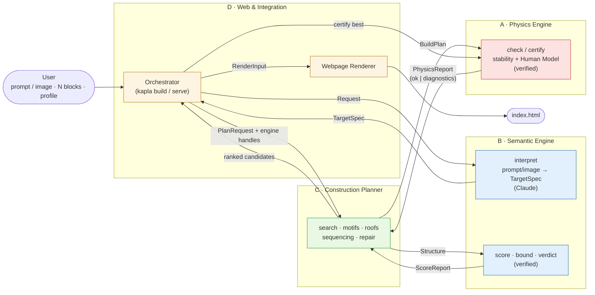
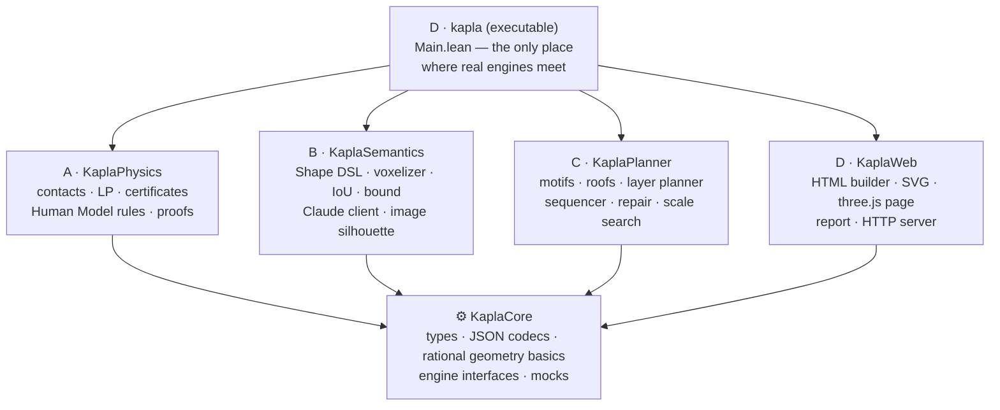
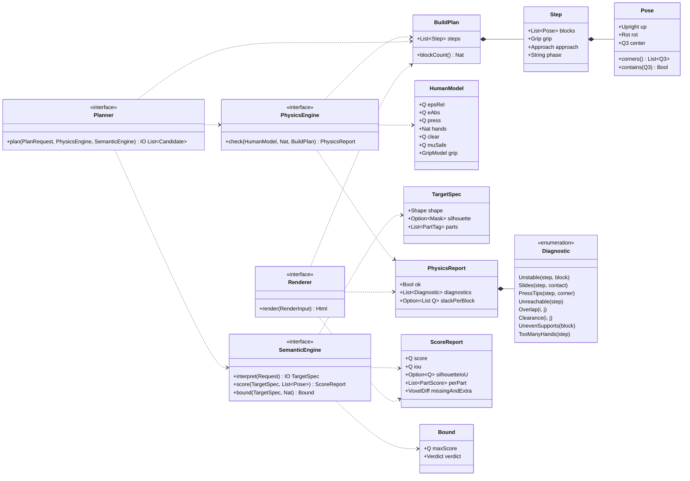
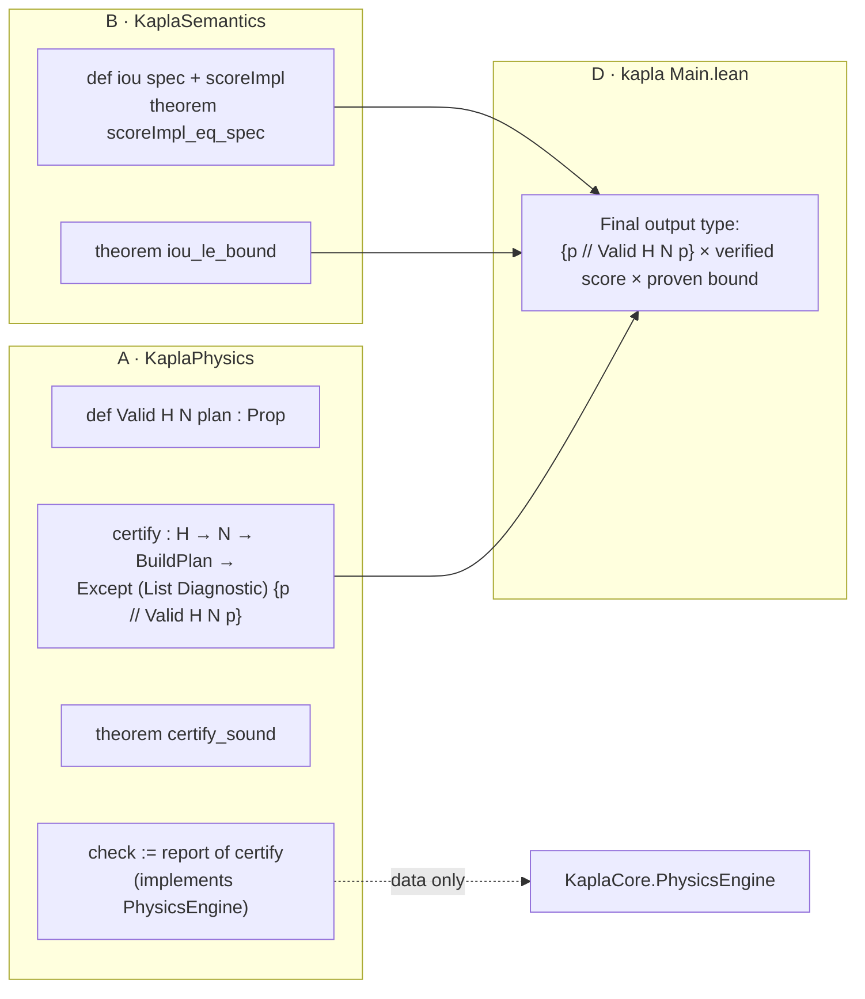
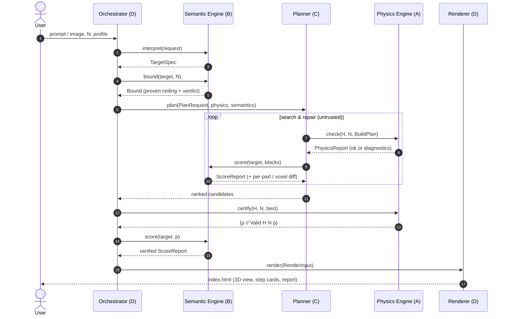
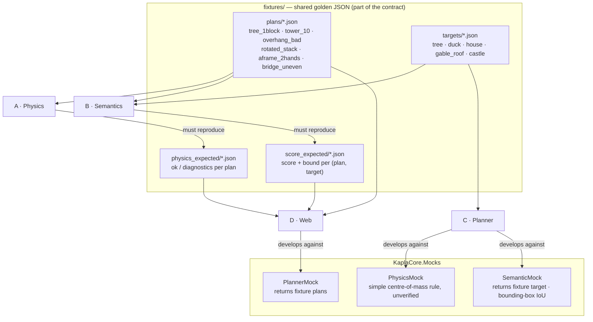
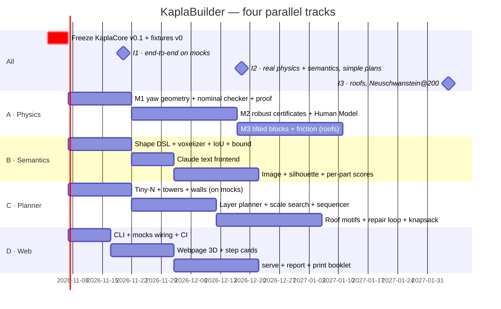

# KaplaBuilder: Component Split for a Team of Four

This document splits the system described in [DESIGN.md](DESIGN.md) into **four independent
components**, one per person. They share **one small contract package**, `KaplaCore`. Every
team codes only against `KaplaCore` (types, JSON formats, interfaces, mocks), so nobody is
ever blocked waiting for another team's engine.

| | Component | Owner | One-line responsibility |
|---|---|---|---|
| **A** | Physics Engine | Person A | *"Does it stand, and can a human build it?"* Verified. |
| **B** | Semantic Engine | Person B | *"What should we build, and how close are we?"* Verified score. |
| **C** | Construction Planner | Person C | *"Which blocks go where, and in what order?"* Search; untrusted. |
| **D** | Web & Integration | Person D | *"Wire it up and show it."* CLI, webpage, fixtures, CI. |
| ⚙ | `KaplaCore` (shared contract) | all four, stewarded by D | data types, JSON, basic geometry, engine interfaces, mocks |

---

## 1. System overview

**Key rule:** the Planner never imports the Physics or Semantic packages. It receives them
as **interface values** (`PhysicsEngine`, `SemanticEngine`) defined in `KaplaCore`. During
development, C plugs in the mocks; in production, D plugs in the real engines.

---

## 2. Package dependencies

Each component is its own Lake library. Arrows mean "imports". The graph has no cycles,
and the only shared node is `KaplaCore`.

| Library | May import | Must **not** import |
|---|---|---|
| `KaplaCore` | Lean core, Batteries | anything else in this repo |
| `KaplaPhysics` (A) | `KaplaCore`, the physics rules `KaplaSpecs.PhysicsRules.*` | Semantics, Planner, Web, the rest of `KaplaSpecs` |
| `KaplaSemantics` (B) | `KaplaCore` | Physics, Planner, Web |
| `KaplaPlanner` (C) | `KaplaCore` | Physics, Semantics, Web |
| `KaplaWeb` (D) | `KaplaCore` | Physics, Semantics, Planner |
| `kapla` exe (D) | everything | — |

D enforces this with a CI script that greps the imports.

The physics rules (what "stable", "solid" and "safe plan" mean) are human-owned, so
they live in `specs/KaplaSpecs/PhysicsRules/`. Physics imports them; the rules import only
`KaplaCore` and each other, never the engine or its proofs.

---

## 3. The contract: `KaplaCore`

This is the only thing all four people must agree on. It is frozen as **v0.1 in week 1**.
After that, changes go through a PR reviewed by all four, and additive changes are
preferred.

Contents of `KaplaCore`:
- **Data**: `Q` (= `Rat`), `Q3`, `Rot` (Pythagorean rotation, exact), `Upright`, `Pose`,
  `Grip`, `Approach`, `Step`, `BuildPlan`, `HumanModel` + profiles, `Shape` (DSL AST),
  `TargetSpec`, `Diagnostic`, `PhysicsReport`, `ScoreReport`, `Bound`, `Verdict`,
  `Request`, `PlanRequest`, `Candidate`, `RenderInput`.
- **JSON codecs** for all of the above, with round-trip tests. JSON is the format of the
  fixtures, the webpage data and the Claude output.
- **Basic geometry** that everyone needs: rational rotations, `Pose.corners`,
  `Pose.contains`, block dimensions. Physics-specific geometry (contacts, clipping,
  separating-axis tests) stays in A's package.
- **Engine interfaces** (Lean `structure`s of functions), as in the diagram.
- **Mocks**: `PhysicsMock`, `SemanticMock`, `PlannerMock`, `RendererMock` (see §5).

### Verified vs. data across the boundary

Proof-carrying types do not cross the `KaplaCore` interfaces. Only plain data does, which
keeps the components independent. The proofs come back together in exactly one place:

---

## 4. One run, end to end

---

## 5. How each person works independently: mocks and golden fixtures

| Person | Develops against | Proves it works by |
|---|---|---|
| A | fixture plans | reproducing `physics_expected/`, plus proofs compiling with no `sorry` |
| B | fixture targets and plans | reproducing `score_expected/`, plus proofs compiling |
| C | `PhysicsMock` + `SemanticMock` | producing plans for every fixture target that the mock accepts. Later the real engines are swapped in with zero code change. |
| D | `PlannerMock` + fixture reports | rendering a webpage for every fixture. `kapla build` runs end to end on mocks from week 3. |

Whoever finds a new interesting case adds a fixture. Fixtures are the shared language
between the teams.

---

## 6. Work packages per person

### A: Physics Engine (`KaplaPhysics`)
- **Owns**: contact detection (polygons, segments, points), polygon clipping and shrinking,
  3D separating-axis tests, the LP solver that generates force certificates, the robust
  certificates (margins, shift budgets), the friction pyramid for tilted blocks, and the
  Human Model rules H1–H9 (`Reachable`, `Clearance`, `ParallelSupportsOK`, press load
  cases).
- **Delivers**: `PhysicsEngine` implementation, `certify`, `Valid`, `certify_sound`,
  `robust_sound`.
- **Does not care about**: what the structure is supposed to look like.
- **Heaviest proof load.** A's scope is bounded by DESIGN.md §2–3.

### B: Semantic Engine (`KaplaSemantics`)
- **Owns**: the Shape DSL semantics, the voxelizer with its correctness proof, IoU,
  silhouette projection, the upper bound `iou_le_bound`, verdict bands, per-part scores
  (so the planner gets a feedback signal such as "tower missing"), the Claude client
  (text/image → `TargetSpec`, validation, retries), image decoding and silhouette mask, and
  the narration text for the report.
- **Delivers**: `SemanticEngine` implementation, proven score and bound.
- **Does not care about**: gravity.

### C: Construction Planner (`KaplaPlanner`)
- **Owns**: scale search, exhaustive search for N ≤ 4, motif library (log-cabin tower,
  round tower, spiral, wall, slab, arch, tree, **roofs**: stepped, leaning-rafter gable,
  A-frame, tipi, hip), layer planner, block-budget knapsack, the repair loop driven by
  `Diagnostic`, the sequencer (build order, 1–2-block steps, grip/approach choice, phase
  labels), and the difficulty rating.
- **Delivers**: a `Planner` implementation.
- **Does not care about**: why something is unstable. It only reads `Diagnostic`. It never
  needs to be proven correct.

### D: Web & Integration (`KaplaWeb` + `kapla`)
- **Owns**: stewardship of `KaplaCore` and the fixtures; `Main.lean` (CLI: `build`,
  `check`, `serve`); the HTML builder in Lean; three.js 3D view with step slider; step-card
  SVGs (offsets, angles, grip hints, two-hand badge); feasibility, difficulty and
  verified badges; print booklet; local HTTP server and input form; CI (build, axiom
  audit, import rules, fixture contract tests).
- **Delivers**: the webpage and the end-to-end pipeline.
- **Does not care about**: how any engine works inside.

---

## 7. Timeline with integration points

| Integration point | What must work | Who is on the critical path |
|---|---|---|
| **I1** | `kapla build` → webpage, using all mocks | D (C delivers early plans) |
| **I2** | Real `check`/`certify` (yaw-only, robust) + real score/bound; planner builds towers and walls; 1-block tree/duck case | A, B |
| **I3** | Tilted blocks + friction; roof motifs; Neuschwanstein@200 with conical tower roofs | A (M3), C (roofs) |

Real-world calibration of the HumanModel (DESIGN M10) is a shared activity after I2.
Everyone builds generated blueprints by hand.
